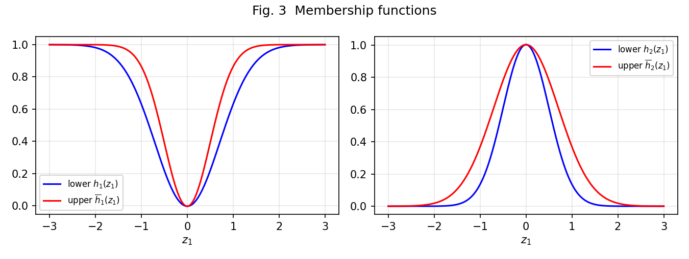
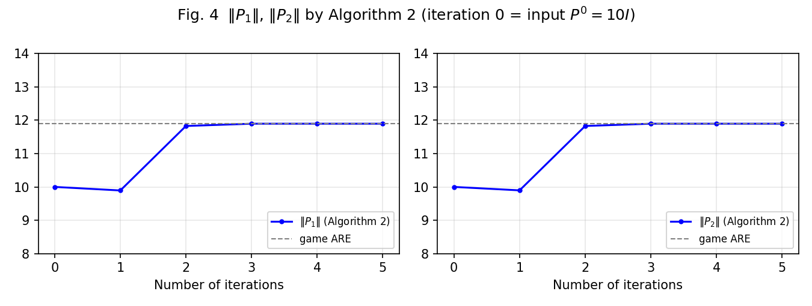
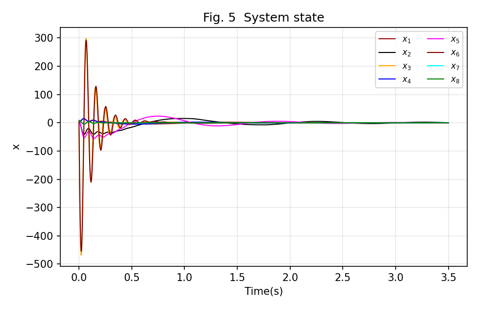
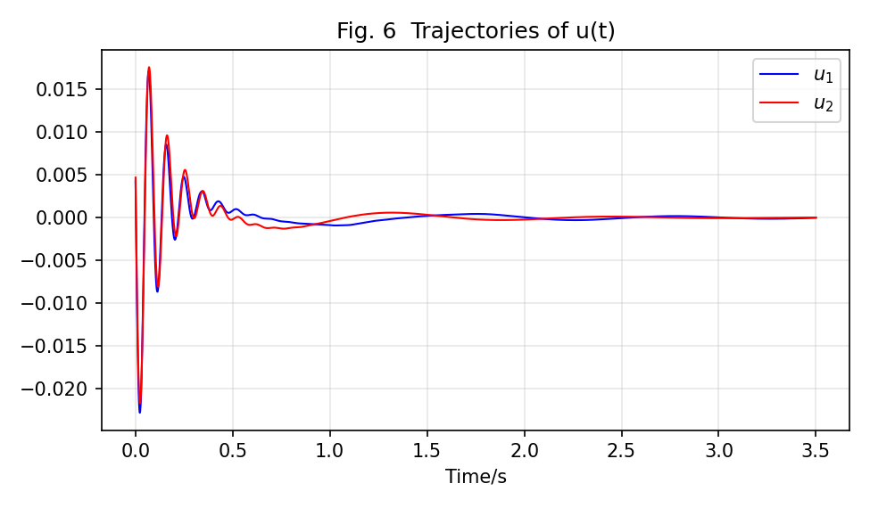
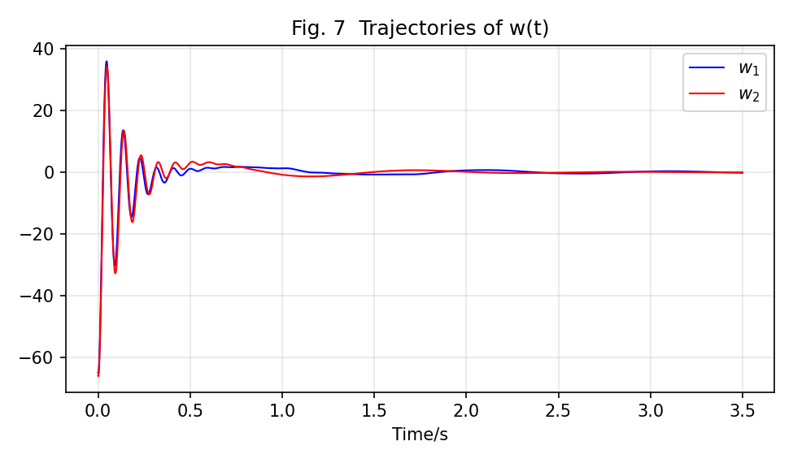
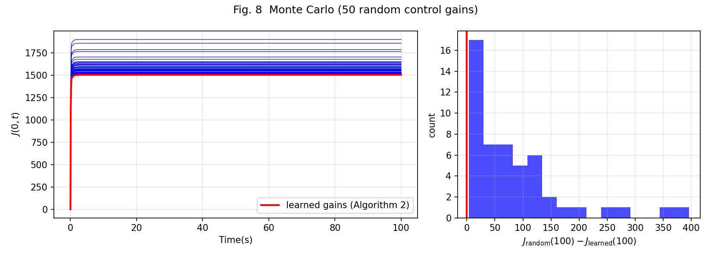

# 区间二型模糊零和强化学习复现

本仓库用一个独立Python脚本实现半车主动悬架算例的模型、策略学习、闭环仿真和图3–8。只依赖NumPy、SciPy、Matplotlib，使用**实际学得的K、N**生成闭环结果，论文打印增益仅作数值对照。

论文：Runkun Li、Wenhai Qi、Guangdeng Zong、Shun-Feng Su、Jinde Cao，*Reinforcement Learning-Based Optimization for Interval Type-2 Fuzzy Unknown Nonlinear System: An Zero-Sum Control Scheme*，IEEE Transactions on Cybernetics，2026。[DOI: 10.1109/TCYB.2026.3720445](https://doi.org/10.1109/TCYB.2026.3720445)。

**当前实现是包含明确公式修正和补充实验设置的复现，尚未逐点重现论文全部数值结果，尤其图6仍有明显幅度差。** 数据驱动结果接近同一模型的独立Riccati参考解，不等于已恢复作者未公开的仿真设置。

导航：[安装运行](#安装与运行) · [参数](#命令行参数) · [文件与输出](#文件与输出) · [流程](#学习与仿真流程) · [图3–8](#图3–8的含义与预览) · [数值结果](#当前保存结果) · [公式修正](#对论文印刷内容所做的修正) · [限制](#复现边界与尚缺信息) · [验证](#验证)

## 安装与运行

需要Python 3.10或以上版本。在仓库根目录执行：

```bash
git clone https://github.com/escape0007/it2fuzzy-zero-sum-rl.git
cd it2fuzzy-zero-sum-rl
python3 -m venv .venv
source .venv/bin/activate
python -m pip install -r requirements.txt
```

Windows PowerShell将激活命令替换为 `.venv\Scripts\Activate.ps1`。常规安装使用 [requirements.txt](requirements.txt) 中的兼容版本范围；[requirements-lock.txt](requirements-lock.txt) 记录本机验证使用的三个依赖版本，具体Python环境见 [验证记录](docs/VALIDATION.md)。锁定文件记录已验证组合，不表示所有Python或操作系统组合都已验证。

运行两种模型：

```bash
python reproduce_it2fuzzy.py --model corrected
python reproduce_it2fuzzy.py --model paper_a53
```

`corrected`为默认模型。`paper_a53`仅把基础矩阵的A(5,3)改为论文印刷的 `ζ₃S_fwI`，保留其他修正，作为单项诊断假设；它不代表作者实际代码，也不代表恢复了全部印刷矩阵。矩阵下标均从1开始计数。

两次运行分别写入 `output/corrected/`、`output/paper_a53/`，可直接比较。相同模型和输出根目录再次运行会覆盖同名输出。查看帮助或另存一次实验：

```bash
python reproduce_it2fuzzy.py --help
python reproduce_it2fuzzy.py --model corrected --out output_local --seed 7
```

第二条命令实际写入 `output_local/corrected/`，可保留仓库已有结果。改变参数后应一起保存该目录中的图、NPZ和JSON，避免把不同设置的结果混用。程序开始时会把 `summary.json` 的 `execution_status`设为`incomplete`，全部输出完成后才改为`completed`；应以该状态判断本次是否完整成功，不能只因目录里已有PNG就认定完成。

## 命令行参数

以下为脚本实际公开的全部CLI选项；未列出的模型常数不是CLI参数。

| 参数 | 默认值 | 含义 |
|---|---|---|
| `--model` | `corrected` | `corrected`或`paper_a53`。选择模型，并决定输出子目录名。 |
| `--duration` | `20.0` | 每条规则、每种探测的数据采集时长，单位秒；须为有限正数且为0.05的整数倍。窗口数为 `duration/0.05`，不是策略更新次数。 |
| `--amp-u` | `500.0` | 补充多频探测的控制通道幅度参数，按本脚本力输入解释为N；须为有限非负数，不改变论文原探测信号。 |
| `--amp-w` | `1.0` | 补充多频探测的扰动通道幅度参数，单位m/s；须为有限非负数。 |
| `--mc-samples` | `50` | 随机控制增益候选数量，整数且至少1；另有1组学得增益作为基准。 |
| `--mc-sigma` | `0.05` | 对两条规则K的每个元素加入独立正态扰动的标准差，须为有限非负数；不是相对百分比。N保持为学得值。 |
| `--mc-horizon` | `100.0` | 蒙特卡洛累计代价的积分终止时间，单位秒；须为不小于0.1的有限值。默认100秒，也可修改。 |
| `--seed` | `2026` | 补充多频探测随机相位与蒙特卡洛采样使用的种子。 |
| `--out` | 脚本所在目录的`output/` | 输出根目录；脚本在其下追加模型名。 |
| `-h`、`--help` | — | 显示帮助并退出。 |

每个补充探测通道叠加4个正弦，单个正弦的系数为对应幅度参数除以2；所以 `--amp-u 500` 不是对实际信号施加绝对值500的硬限幅。频率、Q/R、γ、ε、初态、0.05秒窗口、停止阈值、最大迭代次数，以及图5–7的10秒仿真和0.001秒输出步长均在脚本中定义。

## 文件与输出

```text
.
├── reproduce_it2fuzzy.py       # 唯一复现脚本：模型、学习、仿真、绘图、CLI
├── requirements.txt           # 三个依赖的兼容版本范围
├── requirements-lock.txt      # 本机已验证的依赖版本
├── .gitignore                 # 本地环境、缓存等文件的忽略规则
├── README.md                  # 使用说明、结果与复现边界
├── docs/
│   ├── VALIDATION.md          # 独立完整运行的验证记录与环境
│   └── validation.json        # 数值一致性、参数检查及源码哈希记录
└── output/
    ├── corrected/             # 默认修正模型的一次完整输出
    └── paper_a53/             # 单项A(5,3)诊断变体的一次完整输出
        ├── fig3_membership.png
        ├── fig4_P_convergence.png
        ├── fig5_states.png
        ├── fig6_control.png
        ├── fig7_disturbance.png
        ├── fig8_monte_carlo.png
        ├── learned_gains.npz
        └── summary.json
```

两个模型目录的文件种类相同。输出不存在时，运行对应命令即可生成；下方PNG预览引用当前保存的结果。

[reproduce_it2fuzzy.py](reproduce_it2fuzzy.py) 的编号段落对应：0为论文参数；1为力学矩阵与模糊分解；2为模型已知的策略迭代和参考ARE；3为积分数据采集与离策略学习；4为闭环和蒙特卡洛；5为绘图；6为主流程。

`learned_gains.npz`用于继续使用或核对学得控制器，保存：

| 数组 | 形状 | 含义 |
|---|---|---|
| `P`、`P_ref` | `(2, 8, 8)` | 两条规则的学得P和独立ARE参考P。 |
| `K`、`N` | `(2, 2, 8)` | 维度依次为规则、输入通道、状态分量。K是控制增益，N是扰动增益。 |
| `A_loc` | `(2, 8, 8)` | 当前模型两条局部规则的动力学矩阵。 |
| `B`、`D` | `(8, 2)` | 控制和扰动输入矩阵。 |

例如读取实际学得的K：

```python
import numpy as np

with np.load("output/corrected/learned_gains.npz") as data:
    K = data["K"]
    print(K.shape)  # (2, 2, 8)
```

`summary.json`记录执行状态、本次参数、模糊分解数值误差、两种算法的P谱范数历程、数据秩、学习迭代次数、学得K/N、参考误差、闭环最大输入和蒙特卡洛终端统计。成功完成的状态为 `execution_status="completed"`，参数值在JSON中保存为字符串。NPZ和JSON**没有保存完整训练积分数据、闭环时间序列或所有随机候选的代价轨迹**；需要这些数据时，应由脚本对应函数返回值另行导出，不能从摘要还原全部原始数据。

## 学习与仿真流程

1. 构造所选模型，检查模糊混合 `ΣHαAαz` 与直接非线性模型 `Az+Bρ(z)` 的数值一致性。
2. 先求独立博弈ARE参考解，并运行模型已知的Kleinman形式策略迭代。参考解在程序执行顺序上位于数据学习之前，**不传给数据学习器，也不用于初始化其K、N或回归目标**。
3. 每条局部规则从同一初态开始，用固定行为策略 `K⁰=N⁰=0` 连续采集窗口积分。先检查论文两个标量探测波形的一种广播分配，再为实际学习采集四通道独立多频探测数据。
4. `offpolicy_learning`反复使用同一批积分数据，解出P及改善后的K、N，直到 `max(abs(P新−P旧))<10⁻⁷`。这属于**固定批次的离策略迭代**，不是一边采集新数据一边更新行为策略的在线实现。
5. 将实际学得的两条规则K、N用于非线性闭环，随后运行随机K候选的累计代价比较，保存图3–8与摘要。

学习器只接收 `Δz̄`、`∫zzᵀ`、`∫uzᵀ`、`∫wzᵀ`等积分数据，不接收A/B/D或ARE解。不过数据由已知模型仿真产生，且每条规则单独采集，不能将此直接等同于只测量一辆真实车辆即可获得全部局部数据。

本版本默认 `P⁰=10I`，它进入 `P_hist`并参与首轮停止判断；K⁰、N⁰仍为零。P⁰不是通过 `K=R⁻¹BᵀP⁰`生成行为策略，也不进入首轮回归右端。它是本实现的输入选择，**不只是绘图假设，论文也未确认这个具体初值**。

主要符号为：z是8维状态；u、w各有前后两个通道；H是两条规则的最终权重；P是每条规则的对称矩阵。状态顺序如下：

| 分量 | 含义 | 本脚本物理坐标的单位 |
|---|---|---|
| z₁、z₄ | 前、后悬架变形 | m |
| z₂、z₅ | 前、后车身垂向速度 | m/s |
| z₃、z₆ | 前、后轮垂向速度 | m/s |
| z₇、z₈ | 前、后轮胎变形 | m |

本脚本按受力方程把u解释为作动力，w解释为路面速度。论文表I却将u称为速度输入，原图6也未标纵轴单位；因此这仍是需要澄清的原文不一致，不能据此擅自给u添加一个缩放系数。

## 图3–8的含义与预览

以下预览为默认 `corrected` 模型，均使用仓库内的PNG相对路径。

| 图 | 横轴与纵轴 | 应如何理解 |
|---|---|---|
| 图3 | 前提变量z₁与两条规则的上下隶属度 | 四条上下界函数；不是学习误差，也不是最终H权重的额外曲线。 |
| 图4 | 迭代序号与P的谱范数 `‖P‖₂` | 第0点是输入P⁰=10I，后续为实际批次迭代；灰虚线是同一模型的ARE参考谱范数。保存完整历程，不截成0–4窗口。 |
| 图5 | 0–3.5秒与8个状态分量 | 图例x₁–x₈对应代码z₁–z₈。位移和速度单位不同，叠在一张图上应按通道解释。 |
| 图6 | 0–3.5秒与两个控制通道 | 使用实际学得K的 `u=−ΣHαKαz`，评估时关闭训练探测；尚未复现论文原图的幅值。 |
| 图7 | 0–3.5秒与两个扰动通道 | 使用实际学得N的 `w=ΣHαNαz`；采用博弈扰动反馈工况，不额外叠加道路速度波形。 |
| 图8 | 左图：时间与累计代价；右图：终端代价差及样本数 | 固定学得N，对K逐元素加入高斯扰动。红线是学得增益，蓝线是随机候选；右图比较的是终端，不能推出所有时刻均占优。 |

图8计算 `J(0,t)=∫₀ᵗ(zᵀQz+uᵀRu−γ²wᵀw)dτ`，初始累计代价为0。默认积分到100秒；改变 `--mc-horizon` 会同时改变终端比较的时刻。

| 图3：隶属函数 | 图4：P的谱范数 |
|---|---|
|  |  |

| 图5：八维状态 | 图6：控制输入 |
|---|---|
|  |  |

| 图7：扰动反馈 | 图8：累计代价与终端差 |
|---|---|
|  |  |

`paper_a53`的同名图：[图3](output/paper_a53/fig3_membership.png)、[图4](output/paper_a53/fig4_P_convergence.png)、[图5](output/paper_a53/fig5_states.png)、[图6](output/paper_a53/fig6_control.png)、[图7](output/paper_a53/fig7_disturbance.png)、[图8](output/paper_a53/fig8_monte_carlo.png)。

## 当前保存结果

下表来自仓库当前两份 [corrected摘要](output/corrected/summary.json) 和 [paper_a53摘要](output/paper_a53/summary.json)：默认20秒采集、每规则400个窗口、探测幅度参数500/1、种子2026、50个随机K候选、σ=0.05、100秒累计代价。修改参数或数值依赖后应以新生成的JSON为准。

| 指标 | `corrected` | `paper_a53` |
|---|---:|---:|
| 论文标量探测的广播分配数据秩，规则1/2 | 48 / 49 | 49 / 49 |
| 补充多频探测数据秩，规则1/2 | 68 / 68 | 68 / 68 |
| 批次离策略更新次数，规则1/2 | 5 / 5 | 5 / 6 |
| 最终P谱范数，规则1/2 | 11.897157 / 11.897335 | 12.482575 / 12.760415 |
| 两规则最大P元素误差，相对ARE | 1.224×10⁻⁷ | 1.133×10⁻⁷ |
| K与论文打印值的最大元素差 | 0.0524044 | 0.0519603 |
| N与论文打印值的最大元素差 | 0.313550 | 0.321958 |
| 0–10秒闭环最大绝对控制输入 | 0.0228303 | 0.0231778 |
| 0–10秒闭环最大绝对扰动 | 65.9840 | 69.2850 |
| 10秒末状态二范数 | 0.00923901 | 0.0171958 |
| 学得增益的J(0,100) | 1506.062553 | 1587.597091 |
| 50个候选的终端代价差范围 | 3.40910至396.25810 | 5.85004至403.12677 |
| 终端代价低于学得增益的候选数 | 0 / 50 | 0 / 50 |

论文图4的两个可见末平台约12.483、12.447，但原文没有明确绘图范数与初始化。`paper_a53`规则1的平台和部分N元素更接近打印结果，只能作为诊断线索；其规则2平台仍不同，不能由此确认作者实际保留了A(5,3)印刷值。

论文图6的最大绝对幅度约0.44，两种模型的结果均约0.023。论文图8红线平台约56.53，但其随机协议及具体纵轴计算未充分披露；本实现计算的累计代价J不能直接当作已确认相同指标来算复现误差。

## 对论文印刷内容所做的修正

下表列出代数修正及力学模型解释。这些修正尚未经论文作者确认。

| 位置 | 印刷内容或问题 | 本脚本采用 | 依据与限制 |
|---|---|---|---|
| ζ₂ | `1/Mc + lI·lII/Jθ` | `1/Mc − lI·lII/Jθ` | 根据车身垂向与俯仰方程推导。 |
| A(2,4)、A(3,7)、A(5,4)及规则2的(5,4) | 基础矩阵或局部矩阵中有遗漏、零项或空白 | 补 `−ζ₂SfII`、`−SrI/MwI`、`−ζ₃SfII`；局部规则再加入一次后悬架非线性增量 | 补全弹簧和轮胎力；不能混用基础A与局部A的系数。 |
| A(5,3) | `ζ₃SfwI` | 默认 `ζ₂SfwI` | `paper_a53`仅恢复这一处印刷值，用作假设对照。 |
| A(5,5) | `+ζ₃SfwII` | `−ζ₃SfwII` | 阻尼力与相应速度反向。 |
| H₂末项 | `h2_upper·h2_upper` | `h2_upper·f2_upper` | 与式(2)定义一致，使H₁+H₂=1并恢复相应非线性分解；不保证权重属于[0,1]。 |
| 式(15)的N | `γ⁻²BᵀP` | `γ⁻²DᵀP` | 与式(22)及扰动通道一致。 |
| 式(10)、(16) | `PBR⁻¹P` | `PBR⁻¹BᵀP` | 补齐维度及控制项结构。 |
| 式(20)控制代价项 | `Q−KᵀRK−γ²NᵀN` | `Q+KᵀRK−γ²NᵀN` | 与式(24)后的Qⁱ定义一致。 |
| 秩条件 | 严格大于未知数个数；算例写40 | 满列秩68，等于36个P元素加16个K元素和16个N元素 | 秩不能超过有效独立列数；本脚本还检查每轮回归矩阵的数值秩。 |
| 流程图的行为策略 | `u=−K+E₁`等，缺少z且扰动符号冲突 | `u=−Kz+E₁`、`w=Nz+E₂` | 维度自洽，并与式(6)最终策略符号一致。 |

Q=0.1I₈、R=I₂、γ=1.2、ε=0.01/π和初态 `[2,5,5,2,5,5,8,8]ᵀ` 沿用论文数值。本脚本没有为了匹配图6而放大最终u或替换为打印K。

## 复现边界与尚缺信息

- **探测和采样协议。** 论文两个标量探测波形的逐通道分配没有写全。本脚本的“两路u同用E₁、两路w同用E₂”解释在当前设置下欠秩，不能推广为作者所有可能实现均欠秩。实际学习改用四通道独立多频信号、固定行为策略和一次采集的整批数据。改变采集时长或幅度也不自动保证满秩。
- **局部规则数据与在线流程。** 分规则采样是额外的数据可得性假设；当前复现未实现论文所描述的边采样边更新策略时序。模型已知的参考ARE仅验证当前模型下的数值求解，不提供实车数据访问保证。
- **图6和打印增益兼容性。** `K=R⁻¹BᵀP`、`N=γ⁻²DᵀP`要求同一坐标和同一P。这里D的第7、8行各为−1，配合P的对称性可由打印N约束P的最后两行/列，再核对K的第7、8列；在指定B/R/γ下必须检查这些公式是否兼容。**仅凭P的谱范数约12，不能直接推出K中0.05这个元素不可能。** 原文增益、单位、精确模型或规则对应仍需确认，当前图6未逐点重现。
- **模型变体。** `paper_a53`改变了动力学和由此学得的增益。局部数值更接近论文不能确认该假设，也不能把它称作完整恢复论文矩阵。
- **图7的扰动定义。** 本脚本选择N反馈；它与原文另列的道路速度波形是不同工况。起点接近不能独立证明作者图7采用了完全相同的输入协议。
- **图8的结论范围。** 默认50个随机候选在100秒终端没有比学得增益更低的代价，只支持这批样本、固定N、该初态和该有限时域下的比较。它不证明全局最优、极小极大最优、所有时刻占优或其他随机分布下仍成立。σ=0.05是本脚本设置，不能因为其接近某个打印K元素就视作论文已给出的采样参数。
- **稳定性条件。** 当前 `Q+KᵀRK−γ²NᵀN` 的最小特征值在两种模型下均为负，未满足论文定理3条件(26)的这一充分条件。有限时域状态衰减不替代全局稳定性证明；充分条件不成立也不等于已证明不稳定。
- **隶属度范围。** z₁=0时，因ε及分母 `1−ε`，H₁约−0.003193、H₂约1.003193；另外sin(z₁)作为混合系数也不总在[0,1]。两者是不同的范围问题。本脚本保留这些公式值，不裁剪，以保持与所选非线性模型的分解一致性，不能同时宣称满足全部凸模糊权重假设。

进一步完整复现需要作者的全精度P/K/N、实际模型矩阵与H实现、状态和输入单位或归一化变换、初始策略与在线数据分配、图5–7原始时序和输入切换协议，以及图8的明确指标与随机抽样方案。

## 验证

[docs/VALIDATION.md](docs/VALIDATION.md)记录独立环境下两种模型的完整运行、输出检查和数值核验范围。复核当前结果可重新执行：

```bash
python reproduce_it2fuzzy.py --model corrected --out verification_output
python reproduce_it2fuzzy.py --model paper_a53 --out verification_output
```

比较新目录与已保存结果的 `summary.json`、`learned_gains.npz`及图表。执行耗时和输出路径会变化；参考误差、收敛、数值秩和有限时域轨迹检查能验证本实现的行为，不能据此认定论文原图已完整重现。
